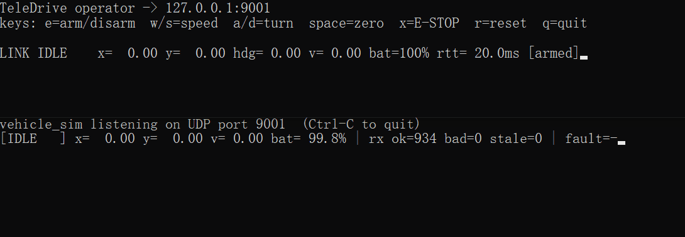
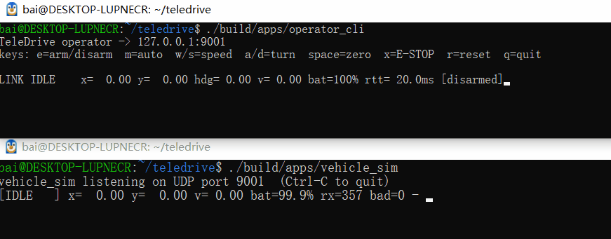
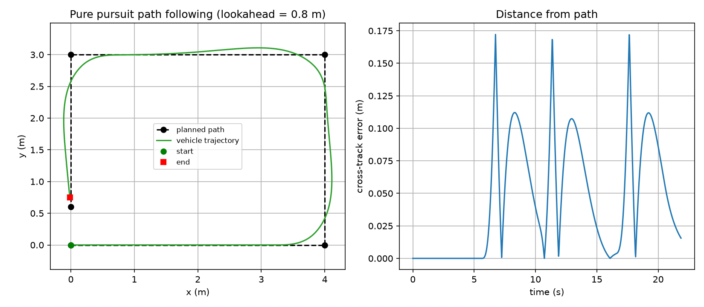
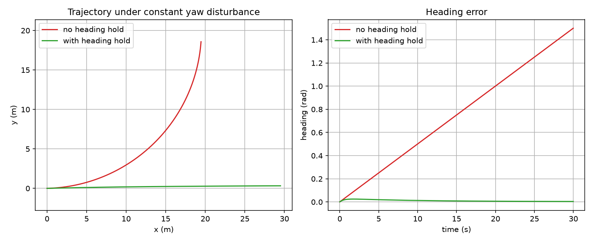
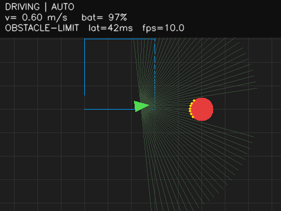
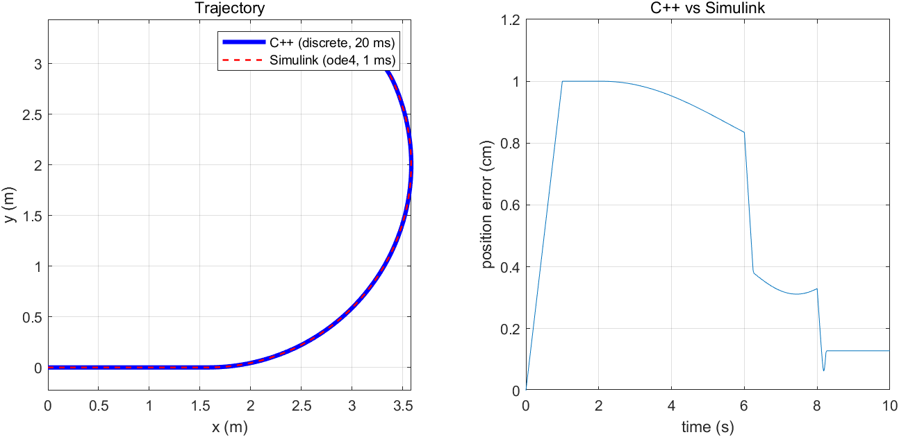

# TeleDrive

A C++17 tele-operation framework with a safety state machine, heartbeat/command watchdog,
and a simulated differential-drive vehicle. Built as a foundation for operator-assist
and semi-autonomous driving features.

## Demo



*The operator console (top) drives the simulated vehicle (bottom). E-stop latches a fault; suspending the
operator process triggers the watchdog and the vehicle brakes automatically.*

## Semi-autonomous mode: pure pursuit

Press `m` after arming to let the vehicle follow a preset path. The path follower runs
*behind* the safety layer: arm switch, command watchdog, E-stop and lidar speed limiting
all still apply, and any manual driving key immediately takes control back.



*Live demo: `e` then `m` starts the run; pressing a driving key hands control back at once.*

Offline simulation of the same controller on a square path. The vehicle cuts slightly
inside each corner, which is inherent to pure pursuit (a larger lookahead cuts more,
a smaller one tracks tighter but oscillates more):




## Operator assist: heading hold

With a constant yaw disturbance (simulating a slipping wheel), the vehicle drifts into a
circle without assistance; the PID heading hold keeps it on a straight line.



## Vision: simulated onboard camera

The vehicle renders its surroundings (path, obstacles, lidar returns, HUD) with OpenCV,
compresses each frame to JPEG and streams it to the operator over a *separate* UDP
channel (control port + 1), fragmented into MTU-sized packets. The operator console
shows the live picture in a window together with frame rate, jitter and an estimated
latency.



Design decisions:

- **Control plane and data plane are separate.** Video uses its own socket and its own
  protocol (different magic number), so video congestion cannot delay the 50 Hz command
  stream or the watchdog. A test shows the vehicle behaves bit-identically with video on,
  off, or with every video packet lost.
- **Newest frame wins.** A frame is split into up to 255 fragments (≤ 1200 bytes each,
  CRC-protected). The reassembler works on one frame at a time and drops an incomplete
  frame as soon as a newer one starts; there are no retransmissions, because a late
  frame is worth less than a lost one.
- **Untrusted input.** Fragment counts, indices, lengths and CRCs are validated;
  fragments of one frame that contradict each other are rejected; the receiver only
  accepts datagrams from the vehicle address.
- **Hello handshake.** The operator sends a small hello datagram once per second so the
  vehicle learns where to send video, and recovers automatically if the vehicle restarts.
- **Latency without clock sync.** The two machines' clocks are not synchronized, so the
  capture timestamp is never subtracted from local time. Jitter is the mean of
  |arrival interval − capture interval|; estimated latency ≈ RTT/2 + jitter.

Measured on the development machine: rendering about 0.4 ms, JPEG encoding about 3.4 ms
(max 3.3 ms in a 40 s run), roughly 20 KB per frame (26x compression), 17 packets per
frame, about 190 KB/s at 10 fps. Rendering and encoding run synchronously inside the
20 ms control cycle.

OpenCV is an optional dependency: without it the vision module is skipped and the rest
of the project builds normally. CI and Docker require it so the vision tests cannot be
skipped silently.

Limitations: the hello handshake is unauthenticated, latency is an estimate rather than
a measurement, and the image is a synthetic top-down render, not a real camera.

## Cross-validation with MATLAB/Simulink

The C++ vehicle model was validated against two independent references on the same
open-loop scenario (commands exported from C++ to CSV, 10 s, 20 ms steps).

| Reference | Method | Max position error | Max heading error |
|---|---|---|---|
| MATLAB re-implementation | same discrete algorithm | 7e-10 m | 6e-10 rad |
| Simulink model | continuous integration (ode4, 1 ms) | 1.0 cm | 0.4° |

The MATLAB script agrees to print precision, which rules out implementation errors.
The Simulink residual comes from the integration scheme: the C++ model integrates
position with the end-of-step velocity, adding about 0.5·a·dt² per step during
acceleration (about 1 cm over the 1 s ramp). The Simulink inputs are delayed by 1 ms
to give the rate limiters a zero initial output, which also contributes to the residual.



## Model-based design: Simulink-generated PID

The PID core was designed in Simulink (`matlab/pid_ctrl.slx`, built by
`matlab/build_pid_model.m`), and C++ was generated with Embedded Coder
(`matlab/gen_pid_code.m`). The generated class lives in `libs/control/generated/`,
so building the project does not require MATLAB.

`HeadingHold` depends on an `IPidCore` interface with two implementations: the
hand-written `Pid` and the generated `GeneratedPid` (a thin hand-written adapter).
Verification:

- Randomized equivalence tests: both implementations agree to ~1e-9 on 5000-step
  random sequences, including heavy saturation (anti-windup)
- The closed-loop disturbance-rejection test runs against both cores and gives the
  same result
- Adapter behaviour (reset, invalid inputs) tested separately: a `reset()` bug in the
  adapter was caught this way, so generated code does not remove the need for tests

Limitations: the model fixes dt = 0.02 s (the 50 Hz control period), so the generated
core is only equivalent to the hand-written one at that rate; input validation (NaN,
bad dt) lives in the hand-written adapter, outside the model.


## Features

- Binary UDP protocol with versioning, sequence numbers and CRC-16
- Transport and clock abstractions (`ITransport`, `IClock`) for deterministic testing
- Safety state machine: Idle / Armed / Driving / Fault, latched faults, E-stop priority
- Command watchdog (200 ms), command limiting, NaN/Inf rejection
- Differential-drive simulation with acceleration limits and battery model
- Replay/duplicate rejection with sequence wrap-around handling
- CI (GitHub Actions) and Docker build, 60+ unit and end-to-end tests

## Build and run

```bash
cmake -S . -B build -G Ninja -DCMAKE_BUILD_TYPE=Release
cmake --build build
ctest --test-dir build --output-on-failure

# terminal 1
./build/apps/vehicle_sim
# terminal 2
./build/apps/operator_cli
```

Keys: `e` arm/disarm, `w`/`s` speed, `a`/`d` turn, `space` zero, `x` E-stop, `r` reset, `q` quit.

## Known limitations

- No authentication or encryption on the link
- Keyboard input cannot detect key release, so an arm toggle replaces a true deadman switch
- Status line assumes a terminal at least 80 columns wide
